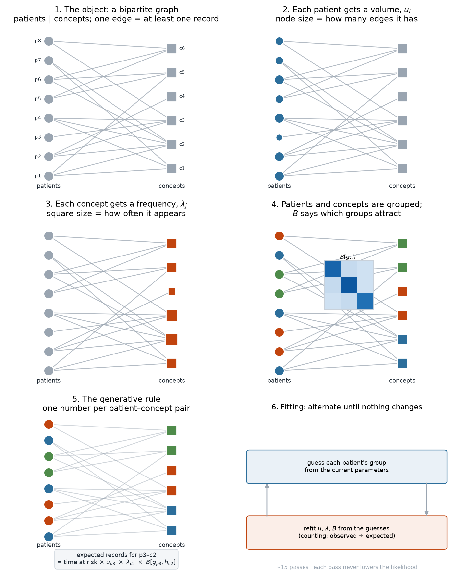

# The model in network terms, and what to read next

---

## Part 1 — The model in six steps



**Step 1 — the object.** A CDM is a bipartite graph. Patients on one side, concepts on the other. An edge exists when a patient has at least one record of a concept. Nothing else is observed; every "disease network" you have seen is a projection of this graph.

**Step 2 — node volume.** Give every patient one number, `u_i`, its contact volume: how many edges it will get. This is the parameter that does the epidemiological work. A patient who attends often accumulates more codes, including incidental ones.

**Step 3 — node frequency.** Give every concept one number, `λ_j`, how often it occurs per unit of contact. Prevalence lives here.

**Step 4 — block structure.** Sort patients into ~15 groups and concepts into ~18 groups. `B[g,h]` says how strongly patient group `g` attracts concept group `h`, above and beyond volume and frequency. This is your thesis's block model, with a likelihood attached.

**Step 5 — the rule.** The expected number of records for one patient–concept pair is the product of four terms:

```
expected = time at risk × u_patient × λ_concept × B[patient group, concept group]
```

Because it is a product over pairs, the probability of the whole database factorises into one term per pair. **That factorisation is the entire technical difference from CiGRAM.** Your model sampled edges without replacement, which couples every edge to every other and leaves no closed form. Here, edges given the parameters are independent, so the graph can be scored.

**Step 6 — fitting.** You don't know the groups. If you did, fitting the rest is counting. If you knew the rest, guessing a group is a comparison. So alternate, about fifteen times, and stop when nothing moves.

---

## Part 2 — Reading, organised by the question you need to answer

I have verified each of these against arXiv, Crossref or PubMed in this session. Where a claim is not verifiable I say so.

### "What family is my model actually in?"

**Karrer & Newman (2011)**, *Stochastic blockmodels and community structure in networks*, Phys Rev E 83:016107. [arXiv:1008.3926](https://arxiv.org/abs/1008.3926)
The degree-corrected SBM. This is the paper that separates "how many edges a node has" from "who it connects to" — the move your `u_i` makes. Read §II for the parameterisation.

**Abbe (2017)**, *Community detection and stochastic block models*, Foundations and Trends in Communications and Information Theory. [arXiv:1703.10146](https://arxiv.org/abs/1703.10146)
The survey. Read it for the distinction between *detection* (does a partition exist?) and *recovery* (can you find it?), and for the information-theoretic limits. This is what tells you whether a claim like "the model found 15 groups" could ever be sharp.

**Rohe, Chatterjee & Yu (2011)**, *Spectral clustering and the high-dimensional stochastic blockmodel*, Annals of Statistics. [arXiv:1007.1684](https://arxiv.org/abs/1007.1684)
Why spectral methods work on SBMs, and when they stop working. Relevant because your thesis's spectral distance is doing the same kind of work.

**Zhao, Levina & Zhu (2012)**, *Consistency of community detection under degree-corrected SBMs*, Annals of Statistics. [arXiv:1110.3854](https://arxiv.org/abs/1110.3854)
The degree-corrected case specifically. Short, and it tells you what can and cannot be recovered when degree heterogeneity is large — which is the situation in a CDM.

### "Can I trust the parameters?"

**Peel, Larremore & Clauset (2017)**, *The ground truth about metadata and community detection in networks*, Science Advances. [arXiv:1608.05878](https://arxiv.org/abs/1608.05878)
Proves no algorithm uniquely solves community detection. This bounds every claim in the project: "the model found groups" is always a statement about a model and its null, never about the world.

**Pamfil, Howison & Lambiotte (2018)**, *Relating modularity maximization and stochastic block models in multilayer networks*. [arXiv:1804.01964](https://arxiv.org/abs/1804.01964)
Modularity is MAP inference under a specific SBM. This formalises the critique you made in the thesis and tells you what your module definition was implicitly assuming.

**Bickel & Chen (2009)**, *A nonparametric view of network models and Newman–Girvan and other modularities*, PNAS. [doi:10.1073/pnas.0907096106](https://doi.org/10.1073/pnas.0907096106)
The same argument from the nonparametric side: a null model is a statistical assumption, not a convention.

### "How do I choose the number of groups?"

**Latouche, Birmelé & Ambroise (2012)**, *Variational Bayesian inference and complexity control for stochastic block models*, Statistical Modelling.
Not verified in this session — I could not confirm a stable identifier. Read it for the ICL criterion, which is the standard alternative to AIC/BIC for mixtures. The lesson from this project is directly relevant: using the *fitting* likelihood for model selection over-selects, because the latent labels are estimated and never counted.

### "How do I get rank, not just blocks?"

**Hoff, Raftery & Handcock (2002)**, *Latent space approaches to social network analysis*, JASA. [doi:10.1198/016214502388618906](https://doi.org/10.1198/016214502388618906)
The ancestor of every latent-position network model, including CiGRAM. Nodes get coordinates; edges depend on distance. Worth reading to see how your geometric intuition was formalised statistically.

**Gopalan, Hofman & Blei (2014)**, *Scalable recommendation with Poisson factorization*, UAI. [arXiv:1311.1704](https://arxiv.org/abs/1311.1704)
Poisson matrix factorisation: users × items with latent factors and counts. This is exactly the factor term added to the model, in a recommendation setting, with variational inference at scale. The closest thing to a blueprint for the rank problem.

**Townes, Hicks, Aryee & Irizarry (2019)**, *Feature selection and dimension reduction for single-cell RNA-Seq based on a multinomial model*, Genome Biology. [doi:10.1186/s13059-019-1861-6](https://doi.org/10.1186/s13059-019-1861-6)
GLM-PCA. Low-rank structure for **count matrices** specifically, which is what a patient × concept matrix is. The methods transfer almost directly; the bioinformatics literature solved this problem before epidemiology did.

### "How should I describe and compare graphs?"

**von Luxburg (2007)**, *A tutorial on spectral clustering*, Statistics and Computing. [arXiv:0711.0189](https://arxiv.org/abs/0711.0189)
The reference for what a Laplacian spectrum does and does not encode. You already know the technique; this is the statement of its guarantees.

### "How do I add time?"

**Butts (2008)**, *A relational event framework for social action*, Sociological Methodology. [doi:10.1111/j.1467-9531.2008.00203.x](https://doi.org/10.1111/j.1467-9531.2008.00203.x)
Events as they happen, with intensity depending on the history so far. This is the principled version of the visit/transition layer. Read for the likelihood, which is where the difficulty lies.

### "What has already been done in multiplex?"

**Mucha, Richardson, Macon, Porter & Onnela (2010)**, *Community structure in time-dependent, multiscale, and multiplex networks*, Science. [arXiv:0911.1824](https://arxiv.org/abs/0911.1824)
Multislice modularity. The canonical method, and the one the field has since found parameter-degenerate.

**Taylor, Shai, Stanley et al. (2016)**, *Enhanced detectability of community structure in multilayer networks through layer aggregation*, PRL. [arXiv:1511.05271](https://arxiv.org/abs/1511.05271)
Summing layers is a very strong baseline. This is the result that kills naive multiplex claims, and it reproduced in this project.

**Bazzi, Jeub, Arenas, Howison & Porter (2020)**, *A framework for the construction of generative models for mesoscale structure in multilayer networks*, Phys Rev Research. [arXiv:1608.06196](https://arxiv.org/abs/1608.06196)
The modern version of what CiGRAM attempted: generative benchmark models with explicit, user-specified structure.

**De Bacco, Power, Larremore & Moore (2017)**, *Community detection, link prediction, and layer interdependence in multilayer networks*, PRE. [arXiv:1701.01369](https://arxiv.org/abs/1701.01369)
The most flexible multilayer SBM, and honest about measuring interdependence rather than assuming it.

### "Will epidemiologists accept the bias argument?"

**Griffith et al. (2020)**, *Collider bias undermines our understanding of COVID-19 disease risk and severity*, Nature Communications. [PMID 33184277](https://pubmed.ncbi.nlm.nih.gov/33184277/)
Conditioning on healthcare contact induces associations among its causes. This is the mechanism the model claims to capture. The ingrown toenail, stated generally.

**Schuemie et al. (2018)**, *Improving reproducibility by using high-throughput observational studies with empirical calibration*, Phil Trans R Soc A. [PMID 30082302](https://pubmed.ncbi.nlm.nih.gov/30082302/)
Negative controls and empirical calibration. The standard your method has to beat, and the experiment in §4 of the previous document is designed against it.

**Lipsitch, Tchetgen Tchetgen & Cohen (2010)**, *Negative controls: a tool for detecting confounding and bias in observational studies*, Epidemiology. [PMID 20335814](https://pubmed.ncbi.nlm.nih.gov/20335814/)
The original statement of the negative-control idea, and the clearest on what it does and does not identify.

**Pastor-Satorras, Castellano, Van Mieghem & Vespignani (2015)**, *Epidemic processes in complex networks*, Rev Mod Phys 87:925. [doi:10.1103/RevModPhys.87.925](https://doi.org/10.1103/RevModPhys.87.925)
The reference for how network structure changes epidemic dynamics. Relevant if claim 3 ever extends to transmission rather than recording.

---

## Part 3 — The three I would actually read first

If you read only three:

1. **Karrer & Newman (2011)** — so you can see your own model in the standard notation, and judge whether the parameterisation is sound.
2. **Gopalan, Hofman & Blei (2014)** — because the rank problem is the live one, and this is the blueprint.
3. **Schuemie et al. (2018)** — because the negative-control experiment is the one that decides whether any of this is a contribution.

Everything else is support.
