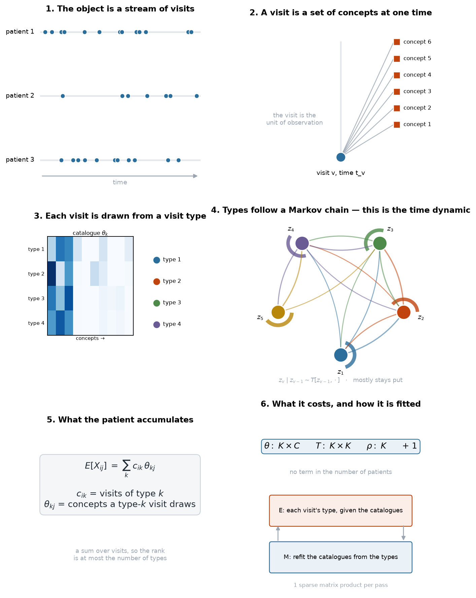

# The visit-anchored model, in network terms

*A restatement of the previous document. The model has changed: time is now part of the object rather than a covariate layered on top of it.*

---

## Part 1 — The model in six steps



**Step 1 — the object is a stream, not a matrix.** A patient is a sequence of visits at times. The previous model collapsed this to a bag of concepts, which is why it had no way to represent order. Here the timeline is the first thing you draw.

**Step 2 — a visit is a set of concepts at one time.** The visit is the unit of observation, which is what the CDM actually is. A patient's record is not "they have 78 concepts"; it is "they came 44 times, and this is what happened each time".

**Step 3 — each visit is drawn from a visit type.** There are K types. Type `k` has a catalogue `θ_k` over the C concepts: what a visit of that type tends to contain. This is the bipartite half of the model — a visit on one side, concepts on the other.

**Step 4 — the types follow a Markov chain.** `z_v | z_{v-1} ~ T[z_{v-1}, ·]`. **This is the time dynamic.** It says that what happens at the next visit depends on what happened at the last one. In the data the chain is strongly persistent: visits cluster into runs of the same type, which is why a patient's record comes to look like a trajectory rather than a bag.

**Step 5 — what the patient accumulates.**

```
E[X_ij] = Σ_k c_ik · θ_kj
```

where `c_ik` is how many visits of type k the patient had. A patient's record is a *sum over their visits*. The rank of the mean matrix is at most K, and K is a knob rather than a consequence of how you cut the partition.

**Step 6 — what it costs and how it is fitted.**

```
θ: K×C        T: K×K        ρ: K        + 1
```

**No term in the number of patients.** The per-patient object `c_ik` is a visit count — a latent draw, not a parameter. Fitting is EM: guess each visit's type given the catalogues, refit the catalogues from the types, repeat. One sparse matrix product per pass; 443,000 visits in five seconds.

---

## Part 2 — What changed, and why it matters

The previous statement described a patient as a bag of concepts with a free propensity and a block structure. That model could be scored and it fitted well, but it had no representation of time at all: two patients with the same concepts in opposite order were identical to it.

This one makes three changes at once:

**Time is structural.** The Markov chain over visit types is the mechanism that produces trajectories. It is not a seasonality term or a calendar covariate; it is the generator of the sequence.

**The unit is the visit.** This matches the CDM, and it makes the time dynamic cheap — you need one transition matrix `K×K`, not a per-patient sequence model.

**Parameters stop scaling with patients.** The old model fitted one propensity per patient. That is fine at 10,000 and untenable at 10⁸. Here the count is `K·C + K² + 2K + 1`.

The cost is that a patient's individuality has to be represented by something other than a free parameter. It turns out to be one number: a heavy-tailed multiplier `u_i ~ Gamma(k)`, with `k ≈ 0.15`. Without it the spectral distance is 0.453; with it, 0.364. One parameter.

**What this buys, measured:**

| model | spectral KS | rank | parameters |
|---|---|---|---|
| fixed-effects block | 0.413 | 8 | N + 1,058 |
| fixed-effects + factors | 0.366 | 75 | N + 12,653 |
| visit-anchored, K=200 | 0.453 | 57 | 195,001 |
| **visit-anchored + heavy tails** | **0.364** | 53 | **195,001, flat in N** |

The visit-anchored model matches the spectral distance of the fixed-effects model with no per-patient parameter. The crossover in fitting cost is around 182,000 patients; below that the fixed-effects model is cheaper, above it this one is, and this one is the only one of the two that represents time.

---

## Part 3 — Reading, by the question you need to answer

I verified each of these against Crossref or arXiv in this session. The one I could not verify is marked.

### "How do I put time into a network model?"

**Butts (2008)**, *A relational event framework for social action*, Sociological Methodology. [doi:10.1111/j.1467-9531.2008.00203.x](https://doi.org/10.1111/j.1467-9531.2008.00203.x)
Events as they happen, with intensity depending on the history. This is now the closest paper to the model: read it for the likelihood construction and for how the history dependence is parameterised.

**Holme & Saramäki (2012)**, *Temporal networks*, Physics Reports 519:97–125. [doi:10.1016/j.physrep.2012.03.001](https://doi.org/10.1016/j.physrep.2012.03.001)
The survey. Read it for the taxonomy — sequence versus interval representations, and why "the network at time t" is usually the wrong object.

**Masuda & Lambiotte (2016)**, *A Guide to Temporal Networks*, World Scientific. [doi:10.1142/q0033](https://doi.org/10.1142/q0033)
The textbook. Chapter 5 covers models of temporal networks, which is the chapter that matters.

**Hawkes (1971)**, *Spectra of some self-exciting and mutually exciting point processes*, Biometrika 58:83–90. [doi:10.1093/biomet/58.1.83](https://doi.org/10.1093/biomet/58.1.83)
Worth reading for the title alone: a point process whose *spectrum* is the object of study. If you want to extend the visit model beyond a first-order Markov chain, this is the family that does it — the interaction kernel is a network over concepts.

### "What is a visit type, statistically?"

**Blei, Ng & Jordan (2003)**, *Latent Dirichlet allocation*, JMLR 3:993–1022.
The visit type is a topic and the visit is a document. LDA is the Bayesian version of the model fitted here; the difference is that LDA puts priors on `θ` and on the per-document mix, which is exactly where the sparsity and the heavy tails would come from. No DOI on the JMLR version; the 2001 NIPS paper is [doi:10.7551/mitpress/1120.003.0082](https://doi.org/10.7551/mitpress/1120.003.0082).

**Gopalan, Hofman & Blei (2014)**, *Scalable recommendation with Poisson factorization*, UAI. [arXiv:1311.1704](https://arxiv.org/abs/1311.1704)
Poisson factorisation instead of multinomial. Matters if you stop conditioning on visit size, and it is the reference for the rank-K structure under a count likelihood.

**Townes, Hicks, Aryee & Irizarry (2019)**, *Feature selection and dimension reduction for single-cell RNA-Seq based on a multinomial model*, Genome Biology. [doi:10.1186/s13059-019-1861-6](https://doi.org/10.1186/s13059-019-1861-6)
GLM-PCA, for count matrices with low-rank structure. The closest thing to a worked example of the estimation problem.

### "Is the structure real, or an artefact of the method?"

**Peel, Larremore & Clauset (2017)**, *The ground truth about metadata and community detection in networks*, Science Advances. [arXiv:1608.05878](https://arxiv.org/abs/1608.05878)
No algorithm uniquely solves community detection. Bounds any claim of the form "the model found 200 visit types".

**Karrer & Newman (2011)**, *Stochastic blockmodels and community structure in networks*, Phys Rev E 83:016107. [arXiv:1008.3926](https://arxiv.org/abs/1008.3926)
Still the reference for separating node volume from node affinity. In this model that separation sits in `θ_k` versus the visit counts.

**Abbe (2017)**, *Community detection and stochastic block models*. [arXiv:1703.10146](https://arxiv.org/abs/1703.10146)
For the limits: how many types can be recovered, at what signal strength. Relevant when choosing K.

### "How do I describe and compare the result?"

**von Luxburg (2007)**, *A tutorial on spectral clustering*, Statistics and Computing. [arXiv:0711.0189](https://arxiv.org/abs/0711.0189)
What a Laplacian spectrum does and does not encode. The spectral comparison is the diagnostic that disagreed with every summary statistic in this project, so it is worth knowing its guarantees.

### "Will epidemiology accept the argument?"

**Griffith et al. (2020)**, *Collider bias undermines our understanding of COVID-19 disease risk and severity*, Nature Communications. [PMID 33184277](https://pubmed.ncbi.nlm.nih.gov/33184277/)
Conditioning on healthcare contact induces associations among its causes. In this model, contact is the visit process itself, which is a cleaner place to put it than a per-patient propensity.

**Schuemie et al. (2018)**, *Improving reproducibility by using high-throughput observational studies with empirical calibration*, Phil Trans R Soc A. [PMID 30082302](https://pubmed.ncbi.nlm.nih.gov/30082302/)
Negative controls and empirical calibration. The benchmark the bias claim has to meet.

**Lipsitch, Tchetgen Tchetgen & Cohen (2010)**, *Negative controls: a tool for detecting confounding and bias in observational studies*, Epidemiology. [PMID 20335814](https://pubmed.ncbi.nlm.nih.gov/20335814/)
The original statement, and the clearest on what a negative control does and does not identify.

### "What was the previous model, and what was wrong with it?"

**Latouche, Birmelé & Ambroise (2012)**, *Variational Bayesian inference and complexity control for stochastic block models*, Statistical Modelling.
Not verified in this session — I could not confirm a stable identifier. Read for the ICL criterion.

The bag-of-concepts model and its results are in `WHERE_THIS_STANDS.md`; the visit model supersedes it but the criticism there still applies to the epidemiology claims.

---

## Part 4 — The three to read first

1. **Butts (2008)** — because the time dynamic is now the core of the model and this is the paper that treats an event stream as the object rather than a derived adjacency matrix.
2. **Blei, Ng & Jordan (2003)** — because the visit type is a topic, and the Bayesian version is where the sparsity and heavy tails should come from rather than being added as a single fitted constant.
3. **Hawkes (1971)** — because a first-order chain is the simplest possible time dynamic, and this is the family that replaces it if the data needs memory beyond one step.
