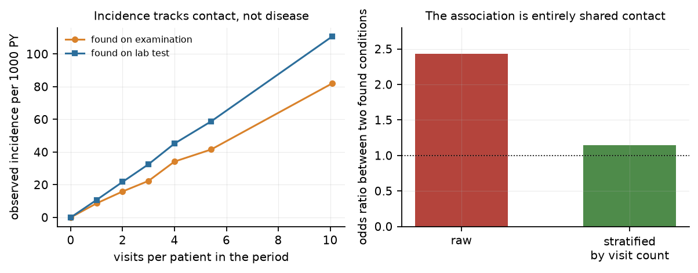
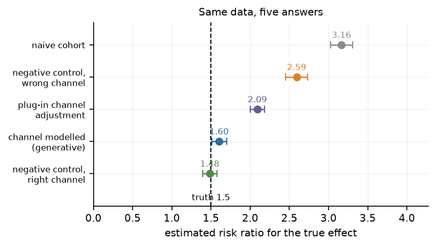
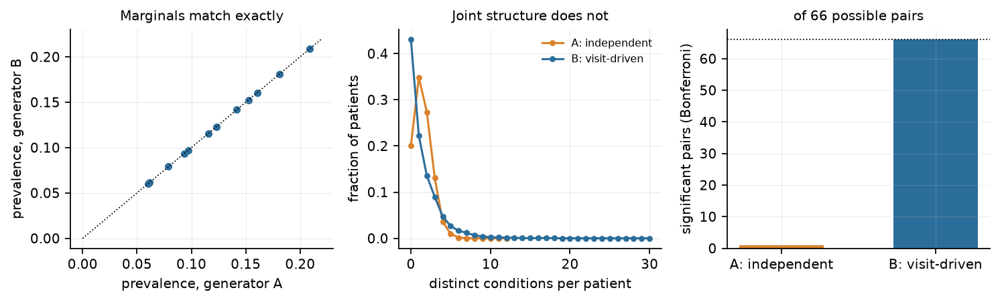

# The null health system

### Two threads, one mechanism: topology-aware synthetic CDMs, and incidence without negative controls

---

## 1. The claim

Synthetic health data is currently judged on **semantic fidelity** — do the codes make clinical sense, do the marginals match, would a clinician believe this patient? That is the axis LLMs are extremely good at, and it is the axis on which existing generators are validated ([Synthea validated on clinical quality measures](https://pubmed.ncbi.nlm.nih.gov/30871520/), not on ascertainment).

The axis that determines whether a method will *work* on real data is **ascertainment fidelity** — does the synthetic database reproduce the process by which real records come into existence? That process is: a patient with a latent propensity to seek care accumulates contacts with the health system; each contact opens certain observation channels; each channel can only see certain things; what is seen gets coded.

These are different axes, they are independently achievable, and only the second one is captured by a topological model. An LLM asked to generate a diabetic patient will produce a canonical diabetic. It will not produce a 78-year-old with fourteen codes, six of which were incidental findings at a visit for something else — because there is no reason for it to. The incidental is exactly what a language model has no mechanism to generate.

That is the first thread. The second thread is its inverse, and it is the more interesting one:

> **If a model reproduces a CDM's topology, it must be reproducing the recording process — because the recording process is what generated the topology. So the model's residual is a candidate estimate of real signal.**

The ingrown toenail is the canonical case. Nobody's toenail causes them to see a doctor; the doctor sees the toenail because they came in for something else and the toenail was there. Its recorded incidence is therefore a function of *how often the patient was examined*, and its apparent association with everything else in the record is an artefact of shared contact. A model that captures the topology has to capture that. Nothing else in the epidemiologist's toolkit does.

---

## 2. Why these are one thread, not two

The synthetic-data thread needs a generator that reproduces the observation process. The bias thread needs a model of the observation process to define what "no effect" would look like. **These are the same object.** Build it once and it serves both purposes:

- used forward, it is a privacy-safe synthetic CDM with the right bias baked in;
- used as a null, it is the reference distribution against which observed incidence is judged.

I have started calling this the **null health system**: a generative model of a specific CDM's observation process, fitted only to aggregates, which answers the question *"what would this database look like if nothing caused anything?"*

That question has no existing answer. Negative control outcomes answer a nearby question — *"what would this contrast look like if there were no effect?"* — and the difference between those two sentences is the whole programme.

---

## 3. What the demonstrations show

I built a visit-driven CDM simulator (`explore/cdm_sim.py`) with an explicit channel structure: a latent care-seeking propensity, a Poisson visit process, an examination channel open at every visit, a laboratory channel open conditionally on care site and on treatment, and conditions that are recorded only when the channel that can see them is open. All numbers below are from `explore/experiments_bias.py`; code and results are in the repo.

### 3.1 The toenail effect is exactly linear in contact

Observed incidence of a condition that is only ever *found* rises from 8.7 to 81.9 per 1000 person-years across visit-count deciles — a factor of nine, with no change whatsoever in underlying disease. The right panel: two such conditions co-occur with odds ratio 2.44, which falls to 1.14 once you stratify by visit count.

This is the mechanism, made arithmetic. It is also the reason a co-occurrence network built from a CDM is mostly a picture of who goes to the doctor.

### 3.2 Differential ascertainment breaks negative controls

Now add an exposure that (a) raises the visit rate by 20% and (b) raises the probability of a lab test by a factor of two — a monitoring drug, in other words. Give it a true risk ratio of 1.5 on a lab-detectable outcome. Estimate the effect five ways.

| estimator | estimate | why |
|---|---|---|
| naive cohort | **3.16** | detection rides on the exposure |
| negative control, wrong channel | **2.59** | calibrates volume, not channel |
| plug-in channel adjustment | **2.09** | observed lab counts are a biased estimate of detection |
| channel modelled (generative) | **1.60** | channel treated as a latent process |
| negative control, right channel | **1.48** | works — if you know the channel |

Three things worth taking from this.

**(i) Negative controls work when the bias is shared.** A null outcome drawn from the *same channel* as the target recovers the truth almost exactly. That is the standard rationale, and it is sound.

**(ii) They fail when ascertainment is channel-specific.** The wrong-channel control corrects 3.16 to 2.59 — better, still 73% too high. This is not a subtle failure mode. A drug that requires monitoring shifts patients into the lab channel, so lab-detectable findings are preferentially inflated and exam-detectable ones are not. Any outcome-specific control from the wrong channel will under-correct.

**(iii) Plug-in adjustment is not enough.** Using each patient's observed lab count to adjust for detection gives 2.09, because `1 − exp(−τL)` is convex in `L`: the plug-in over-estimates detection for patients with few tests, compressing the contrast. You have to model the channel, not measure it. That requires a generative model — which is the argument for the whole programme, arrived at from the applied direction.

### 3.3 Marginal fidelity cannot see any of this

Two generators, **identical marginal prevalence for all twelve conditions**, by construction:

| | A: independent ("textbook") | B: visit-driven |
|---|---|---|
| max distinct conditions per patient | 7 | 30 |
| significant pairs (Bonferroni, of 66) | **1** | **66** |

A marginal-fidelity metric rates these two databases as equally good. A method tuned on A will find a clean world; the same method on B reports sixty-six associations, none of which is causal.

The "textbook" generator here is a stand-in, not an LLM — I have not run an LLM. It is the closest non-LLM analogue of what an LLM does by default: sample conditions from a prior, with no visit process. **Whether an LLM actually behaves this way is a hypothesis to test, not a result** — which is what §6 is for.

---

## 4. Workstream 1 — the topology-aware CDM

### 4.1 What it has to be

Not a new network model. A CDM-shaped generative model with four structural commitments:

1. **Node = patient, with a latent care-seeking propensity `u_i`.** This is CiGRAM's `θ_i` under a different name, and it is the reason the thesis is relevant here at all: `u_i` sets both how many records a patient has and what kind of records they are.
2. **Events arrive as a point process, not as a fixed set.** Visits are Poisson with rate `ν_i ∝ u_i`. This is the "fixed density, event-budget" choice from CiGRAM — you condition on the number of events, not on a degree sequence — and it is the right choice here because you observe visits, not propensities.
3. **Channels are layers.** Examination, laboratory, imaging, prescribing, referral. A condition is only observable through the channels that can see it, and channels open conditionally on site, on visit type, and on treatment. This is CiGRAM-M with `rho` for shared propensity and a layer-specific detection parameter.
4. **Detection is a separate parameter from occurrence.** `λ_c` is how often something happens; `ε_c` is how likely it is to be seen. Everything in §3 follows from conflating them.

### 4.2 What it must match, and against what

Fit against a target CDM on: visit-rate distribution, codes-per-patient distribution, the pairwise co-occurrence matrix given marginals, the channel mix per visit, and the distribution of intervals between first and last record. Validate on a held-out database, not on the fitting one.

### 4.3 The privacy argument is structural, not statistical

The model is parameterised by a few dozen aggregates: a visit-rate distribution, per-channel detection rates, a mixing structure. That is a model card you can publish. It contains no record-level data, so it cannot memorise a patient, and it cannot be prompted into regurgitating one.

That is a different kind of guarantee from "we fine-tuned an LLM and did not observe leakage". It is also different from differential privacy, which would let you publish the parameters with a formal bound; the two compose.

The caveat worth stating: a *pretrained* LLM that has never seen the target database is also not a patient-level disclosure risk. The risk arises when an LLM is fine-tuned on, or prompted with, records from the system you are trying to protect — which is exactly what people do when they want realistic synthetic data.

### 4.4 The composition, which is probably the actual product

Neither generator alone is right. Three ways to combine them:

- **LLM as renderer.** The topology model emits the event skeleton — patient `i`, visit `t`, channel `c`, concept `x`. The LLM turns that into notes and free text. It never sees a patient, so nothing can leak.
- **LLM as proposal, topology as filter.** The LLM proposes clinically plausible condition sets; the topology model accepts, rejects, or reweights them so that the realised marginals and contact structure match the target. Rejection sampling with a language-model proposal and a mechanistic acceptance test.
- **LLM as adversary.** Use it to generate the "textbook" database and measure how far it is from the target on the ascertainment axes. That is §6.

There is precedent for the first of these — generative AI has already been used to help develop Synthea models ([2026](https://pubmed.ncbi.nlm.nih.gov/41502536/)) — but not, as far as I can find, as a structural constraint on the generated record's *topology*.

---

## 5. Workstream 2 — the null health system

### 5.1 Why incidence designs have no negative controls

A negative control outcome is a **contrast**: by design the effect is null, so any estimated effect is bias, and the bias distribution estimated from many such controls can be transferred to the target. The transfer requires **exchangeability of bias across outcomes** — the assumption that the target and its controls are mismeasured in the same way.

An incidence estimate is a **level**, not a contrast. Its bias is outcome-specific, because it depends on that outcome's own detection probability and its own channel. You cannot transfer a level from another outcome, because the level is not a shared quantity. This is the precise reason negative-control calibration does not solve incidence.

What you need instead is the level you *would* have seen with no true effect: `E[observed incidence | no effect, same observation process]`. That is a synthetic null, not an observed one. Generating it is exactly what the null health system does.

### 5.2 The framing that will land with epidemiologists

This is indirect standardisation, with the standard population replaced by the observation process. Age–sex standardisation asks "what would this rate be if the age–sex mix were standard?" The null health system asks "what would this rate be if the contact structure and channel mix were standard, and nothing caused anything?"

Same logic, different standard. That should be the abstract's first sentence.

### 5.3 The identifiability warning, which is the thing most likely to go wrong

Your formulation — *"a true topological model representing a given CDM would, by definition, have to capture the residual bias"* — is right, but only under an identification condition that it is easy to miss.

**Fitting the topology is not identifying the mechanism.** Several different observation processes can produce the same degree distribution, the same co-occurrence matrix, the same clustering. If you fit topology without identification, you get a model that reproduces the output for the wrong reason, and then "residual" means "model misspecification", not "bias" — and the whole inference collapses.

This is CiGRAM's own history, and it is worth taking seriously as a warning rather than a criticism. The thesis fitted summary statistics well and still could not say what the parameters meant, because there was no likelihood; the specification was underdetermined by construction. The successor cannot repeat that. Concretely: the observation model needs a likelihood (or a calibrated simulation-based posterior), the channel assignment needs to be identified rather than assumed, and the fitting procedure needs to be able to *reject* the model.

The good news is that this makes the problem easier, not harder. A hierarchical model with a small number of mechanisms and a likelihood is more identifiable than a flexible generator, because you are forcing the data to choose among mechanisms you can name.

---

## 6. The LLM head-to-head

The comparison worth running is not "which generator is more realistic". It is **"which generator's errors matter"**. Four axes, all measurable:

| axis | metric | predicted winner |
|---|---|---|
| **Marginal fidelity** | mean total-variation distance across concepts vs. the target CDM | LLM |
| **Topology fidelity** | L1 distance on codes-per-patient; co-occurrence correlation given marginals; visit-rate distribution; channel mix | topology |
| **Downstream bias** | fixed panel of known-positive and negative-control pairs; measure calibration and coverage | topology |
| **Privacy** | nearest-neighbour distance to training records; canary insertion; membership inference | topology (pretrained LLM ties) |

The decisive experiment is the third. Take a real CDM, fit the topological model, generate a synthetic database, and run the same analysis panel on real and synthetic. Then do the same with LLM-generated data. If a method selected on LLM data performs worse on real data than the same method selected on topology-generated data, the ascertainment axis is the one that matters and the paper writes itself.

**What would falsify the whole thing:** if LLM-generated data, given a reasonable prompt, reproduces the codes-per-patient distribution and the co-occurrence structure of the target. I do not think it will — but the protocol has to be able to show that it does, which is why the metrics are fixed in advance.

---

## 7. What is genuinely new, and what is not

I want to be blunt about this because it determines where to submit.

**Not new.** Ascertainment bias in EHR data is well known. Detection bias, collider bias and the co-occurrence-is-not-interaction problem are documented ([Griffith et al. 2020](https://pubmed.ncbi.nlm.nih.gov/33184277/); [Monchka et al. 2022](https://pubmed.ncbi.nlm.nih.gov/35676621/)). Negative controls and empirical calibration are established and mature ([Lipsitch et al. 2010](https://pubmed.ncbi.nlm.nih.gov/20335814/); [Schuemie et al. 2018](https://pubmed.ncbi.nlm.nih.gov/30082302/)). Synthetic patient generators exist and are validated ([Synthea](https://pubmed.ncbi.nlm.nih.gov/29025144/); [validity study](https://pubmed.ncbi.nlm.nih.gov/30871520/)). Latent-space network models are thirty years old.

**New, or at least unoccupied.**

1. **A generative null for incidence.** Not a contrast calibration — a synthetic reference distribution for a level. Nothing in the negative-control literature does this, because it requires a model of the observation process rather than a set of control outcomes.
2. **Channels as the unit of ascertainment.** The framing that breaks negative controls is not "the exposure changes how much we observe" (known) but "the exposure changes *which channel* we observe through" (my §3.2). That is a specific, testable, and — as far as I can tell — unnamed mechanism.
3. **Evaluating synthetic health data on ascertainment rather than marginals.** The demonstration in §3.3 is, I think, the cleanest result in this document: two databases with identical marginals and 1 versus 66 significant associations. Any fidelity metric that cannot separate them is measuring the wrong thing.
4. **Composing a mechanism model with an LLM.** Straightforward engineering, but nobody appears to be doing it as a *constraint* rather than as a renderer.

**The honest risk** is that a referee says "this is detection bias with extra steps". The rebuttal has to be quantitative and pre-empted in the introduction: detection bias is diagnosed qualitatively and cannot produce a null distribution; this produces one, and it is calibrated, and here is it failing to reject a known null and rejecting a known positive.

---

## 8. What I would do first

**Weeks 1–3 — fit the observation model to a real CDM, parameters only.** Visit-count distribution, codes-per-patient distribution, channel mix by care site, interval distribution. No outcome analysis. The question is only: can a four-parameter observation model reproduce these? If not, the programme stops here, cheaply.

**Weeks 4–6 — the null health system, validated on negative controls.** Generate the null; check that observed negative controls land inside it and a handful of known positives land outside. This is the credibility test and it must come before any applied claim.

**Weeks 7–9 — the marginal-equivalence demonstration on real data.** Compute what §3.3 shows, but for the real CDM: how many of its apparent associations survive a contact-matched null? This is publishable on its own and it is the "so what".

**Weeks 10–13 — the LLM arm.** Fix the prompt, fix the metrics, run both generators, compare. Write it as a separate paper; it will be judged by a different community and should not be load-bearing for the first one.

**Sequencing note.** The temptation will be to start with the LLM comparison because it is topical. Don't. The LLM comparison has no value until the ascertainment axis is defined, and that definition is the contribution. Do the null health system first, then use it as the yardstick.

---

## 9. Files

| Path | What it is |
|---|---|
| `explore/cdm_sim.py` | Visit-driven CDM simulator with explicit channels |
| `explore/experiments_bias.py` | The three demonstrations in §3 |
| `results/toenail.json`, `negative_controls.json`, `marginal_equivalence.json` | Raw numbers |
| `figs/fig5–7*.png` | The three figures above |
| `REPORT.md` | The CiGRAM review and the five original angles; this document supersedes angle (E) and extends (A) |

**Caveats.** The simulator is illustrative, not calibrated to any real database; the parameter values were chosen to make the mechanism visible, and the effect sizes in §3.2 are larger than a well-designed study would show. No real OMOP data was used. No LLM was run. The "textbook" generator in §3.3 is a proxy for an LLM, not a measurement of one.
