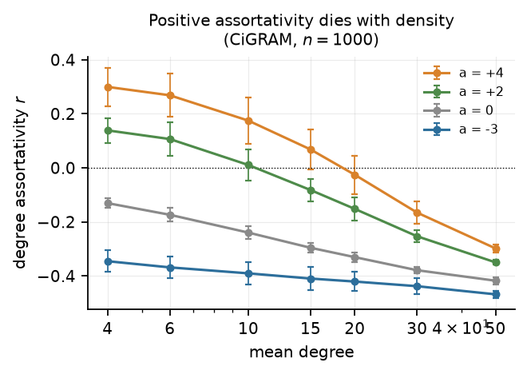
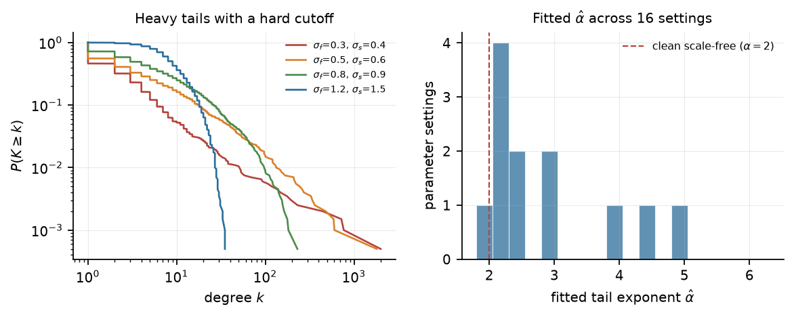
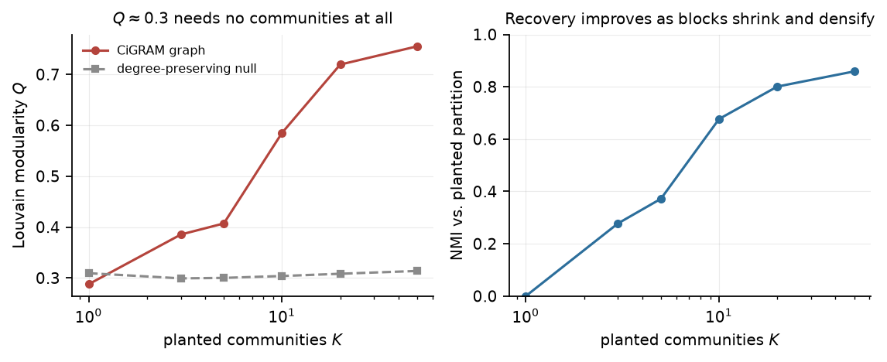
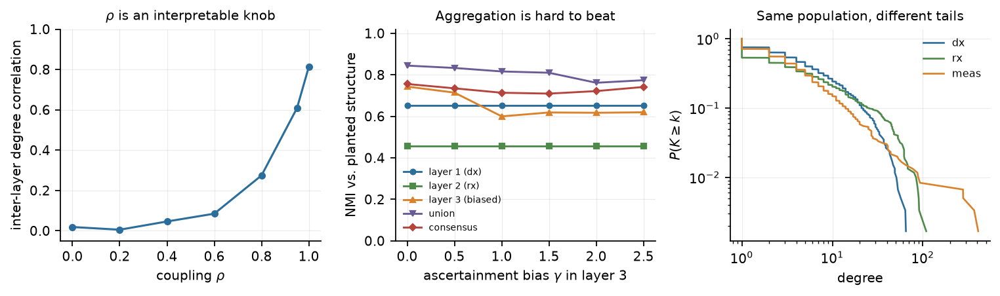

# CiGRAM after eleven years

### A review of the model, the state of the multiplex field, and a route from latent geometry into OMOP epidemiology

Jamie — I read the thesis (247 pp., Nottingham 2015), the repo as it stands today, and the surrounding literature. I also reimplemented CiGRAM in NumPy so I could test its claims rather than repeat them. Four findings are worth your time:

1. **You were right that it can't do power laws, but for a more specific reason than you remember.** The model *can* hit a fitted exponent of α ≈ 2. What it cannot do is hit α ≈ 2 without also making one node adjacent to a third or more of the network — and in the most extreme settings, to all of it. The exponent isn't the failure; the shape is.
2. **You were also right that power laws were overrated** — and the field moved your way. Broido & Clauset's survey of ~1000 networks found strongly scale-free structure is rare and log-normal fits most ([Nat Commun 2019](https://doi.org/10.1038/s41467-019-08746-5)). The benchmark CiGRAM was measured against assumed power laws everywhere; most real networks don't have them. The target was the artefact, not just the model.
3. **The thesis's most durable idea is not the graph model, it's the module definition** — "a module is indistinguishable from a non-modular random graph." I measured this: a CiGRAM graph with *zero* planted communities yields Louvain modularity Q ≈ 0.29. That number is the useful export.
4. **The multiplex gap you could actually fill isn't the one you'd expect.** Multiplex methods are crowded and parameter-degenerate. But the thing CiGRAM is unusually good at — generating a network whose *only* structure is a specified marginal propensity — is exactly the null model that multimorbidity epidemiology lacks.

The last point is the proposal. Everything before it is the argument for it. A follow-on document, [PROGRAMME.md](PROGRAMME.md), takes the synthetic-CDM angle from §8(E) and the ascertainment angle from §8(A) and develops them together; it supersedes both.

---

## 1. Where the artefacts actually stand

**The thesis.** *A probabilistic model for the analysis of modular structure in complex biological networks*, University of Nottingham, 2015. Chapter 4 is an empirical study of co-expression networks and module-detection disagreement; Chapter 5 is CiGRAM; Chapter 6 is parameter fitting by particle swarm optimisation; Chapter 7 is the benchmarking application. A copy is in `explore/thesis-james.pdf` and the extracted text in `explore/thesis.txt`.

**The repository.** Last commit 2018-10-09, version 0.1.5. It is Python 2-era: `g.degree().values()`, `networkx` 1.x semantics, `inspyred` for PSO, `netlsd` for spectral distance, a Boost-dependent C++ core, Travis CI. On a current stack it will not build without work. That matters for the argument below, because one of the angles (E) is essentially "make this run again, for other people."

Worth saying plainly: the model was never published as a paper. The thesis is the only citable description, and it is thorough. Chapter 5 is genuinely reimplementable — I did it from the text alone, and the pseudo-code and equations were sufficient. That is rarer than it should be.

---

## 2. The model, restated

Strip the wrapped-Gaussian language and CiGRAM is a one-dimensional latent-rank model. Each node gets an angle

```
theta_i ~ WrappedNormal(0, sigma_f)      r_i = |theta_i| in [0, pi]
```

a score that is a monotone function of that radius

```
alpha_i = g(theta_i; mu = pi, sigma_s)   beta_i = alpha_i / sum_j alpha_j
```

and edges are drawn without replacement at fixed density with weight

```
P(i -> j)  proportional to  beta_j * exp(-a * delta_ij)
delta_ij = |r_i - r_j| / pi
```

Communities are fixed-density blocks, each with its own latent position on the same circle, sizes proportional to a block-level score, an inter-community edge fraction e_k, and an overlap probability p_o.

Three consequences follow, and they explain almost everything the thesis observed but attributed to model complexity:

**(a) Degree and position are the same variable.** Because alpha is monotone in r, expected degree is a deterministic function of one scalar. "How many edges a node gets" and "who it connects to" therefore cannot be varied independently, so assortativity is not a free parameter — it is whatever falls out of the weight structure interacting with sampling without replacement. At a = 0 that interaction is *disassortative* (r ≈ -0.13 at k-bar = 4, -0.33 at k-bar = 20), because hubs saturate: a node already adjacent to most of its neighbours can only pick up the ones it is not yet connected to. Positive a has to overcome this gradient, and it only succeeds in sparse graphs. That is the thesis's §5.1.4 result with the mechanism exposed.

**(b) The tail dies faster than any polynomial.** Over the range where nodes actually sit, log alpha_i is a smooth decreasing function of r_i, and r_i has a Gaussian tail. Composing the two gives a degree distribution whose upper tail is Gaussian-driven, not polynomial. It cannot be made scale-free by tuning; it can only be made to *look* scale-free over a finite range, and I show below exactly what that costs. Your instinct that it "couldn't really generate power laws" was correct, and the reason is structural rather than a matter of parameter choice.

**(c) Fixed density leaves the block-interaction underdetermined.** Fixing m in advance means any local heterogeneity must be paid for elsewhere. The thesis reports that heterogeneity collapses as K rises; in my reimplementation it degrades only mildly (k_max falls from 178 at K = 1 to 126 at K = 100, coefficient of variation 1.81 → 1.32). The discrepancy is informative: it hinges on how inter-community edges are allocated, and that allocation is not an independent parameter. The model has no knob for "how much of a hub's degree may be cross-community," so the most consequential mechanism in the modular version is left implicit. Worth fixing in any successor.

---

## 3. What a reimplementation shows

I wrote a faithful NumPy version (`explore/cigram_core.py`, ~380 lines) and probed five claims. Code and results are in `explore/experiments.py`, `results/`, `figs/`.



**The density limit is real and reproducible.** At mean degree 4, a = +4 gives r = +0.30; by mean degree 20 it gives -0.03; by 50, -0.30. Disassortativity (a = -3) is monotone in density and essentially unrestricted. So the thesis's asymmetry is confirmed and is stronger than the text claims: CiGRAM can make disassortative networks at any density and assortative networks essentially only in the sparse regime.



**The power-law question, precisely.** Across 16 parameter settings the fitted tail exponent alpha-hat ranges from 1.7 to 10.1, and nine of sixteen land in [2, 3] — the range usually reported for empirical networks. So CiGRAM *can* produce plausible exponents. But the exponent is almost perfectly predicted by how degenerate the graph is:

| largest hub k_max / n | fitted alpha-hat |
|---|---|
| 0.88 – 0.91 | 2.04 – 2.13 |
| 0.33 – 0.63 | 2.25 – 2.39 |
| 0.01 – 0.16 | 2.45 – 10.1 † |

Every setting with alpha-hat < 2.4 has a hub adjacent to at least a third of the network; every setting where the hub touches less than a fifth has alpha-hat >= 2.45 († one exception, alpha-hat = 1.68, whose power-law fit is rejected anyway at KS = 0.13). In the most extreme configurations the largest hub is adjacent to *every other node* — the graph is a star with a decorative fringe.

So the apparent power law is one dominant hub plus a bulk. It passes an exponent test and fails an eyeball test. This is the honest version of your memory of the model, and it is a sharper critique than "it can't do power laws": it *can*, but only by degenerating.



**The result I did not expect, and the one I'd build on.** In a CiGRAM graph with *no* planted community structure (K = 1), Louvain finds modularity Q = 0.29, against 0.31 for a degree-preserving null of the same graph. In other words: a graph generated with the explicit intention of having no modules yields a partition with Q ≈ 0.3, and the degree-preserving null yields slightly *more*. The thesis's central assumption — that a module is indistinguishable from a random graph — is not a philosophical position; it is a measurable calibration, and the calibrated number is about 0.3 for this degree distribution.

The right panel is the flip side: recovery of planted structure improves steadily with K, because blocks shrink and densify. Detectability is driven by block density, not by the sophistication of the generator. That is a useful reminder for anyone benchmarking clustering on synthetic data.

---

## 4. An honest scorecard against 2026 standards

You said the work "wasn't great at the time." It was better than that, and worse than it needed to be, in specific ways.

**What would not pass review now.** The fatal gap is the absence of a likelihood. Fixed-density sampling without replacement means there is no closed-form probability for a graph, so everything downstream is comparison on hand-weighted summary statistics — the fitness function in the repo literally computes `KS + 0.5*(clustering + assortativity + log max degree)`. Those weights have no interpretation; there is no parameter uncertainty; there is no test that can *reject* the model; and "good fit" means "these four numbers are close," which is not a statistical statement. An SBM-based reviewer would not get past this.

**What was ahead of its time.** The fitting pipeline — optimise model parameters so that simulated summary statistics match an observed graph — is simulation-based inference. In 2015 that was particle swarm on a hand-built distance; today it is ABC-SMC, or a neural posterior estimator trained on simulations, and it returns a posterior over (sigma_f, sigma_s, a, K, e_k) rather than a point. The thesis does exactly the right thing procedurally and is held back only by the era's tooling. That is worth reclaiming, and it is angle (A) below.

**What genuinely survives.** Three things:

- *The module definition.* "A module is a group of nodes that cannot be meaningfully subdivided; a random graph is indistinguishable from a module" is a clean, falsifiable idea, and it is the right response to the modularity-maximisation literature's null-model confusion. It is arguably the most citable thing in the thesis.
- *Fixed density as a modelling choice.* SBMs condition on the degree sequence; CiGRAM conditions on the number of edges. For administrative data that is the natural direction, because you observe m co-occurrences, not the degrees. This is a real advantage in the epidemiological setting and it is underrated in the thesis.
- *The geometric coupling parameter a.* Encoding assortativity as a distance penalty rather than a mixing matrix is unusual and, in a multiplex setting, more interpretable than a block-probability matrix (see §6).

**What was overrated at the time, and is now settled.** Power laws. Broido & Clauset ([2019](https://doi.org/10.1038/s41467-019-08746-5)) applied a severe test to ~1000 networks and found strongly scale-free structure rare, with log-normal fitting most. CiGRAM produces heavy-tailed but bounded degrees — which is where most empirical networks now turn out to sit. The benchmark it was judged against (LFR, with a built-in tau = 2 power law) was itself the artefact. You were measuring CiGRAM against a target that most real networks don't hit either.

I'd put it this way: CiGRAM's failure was not that it couldn't do power laws, it was that it couldn't articulate what it *did* do, in a language the field was using. The language that would have worked — "this is a latent-rank model with heavy-tailed but not scale-free degrees, calibrated to a fixed edge count" — took another five years to become standard.

---

## 5. Multiplex: what's actually there

Short version: the multiplex methods literature is crowded, its central method is parameter-degenerate, and the strongest result in it is a negative one.

**Four families of generative model.**

- *Multiplex SBMs*: [Barbillon et al. 2017](https://arxiv.org/abs/1501.06444) (shared blocks, layer-specific probabilities, variational EM), [Vallès-Català et al. 2016](https://arxiv.org/abs/1411.1098) (invert aggregation — infer layers from one graph), [Stanley et al. 2016](https://arxiv.org/abs/1507.01826) (strata: coupling as a *partition of layers*, not a parameter), [De Bacco et al. 2017](https://arxiv.org/abs/1701.01369) (overlapping communities, per-layer affinity, plus an explicit layer-interdependence measure). All likelihood-based. None has latent geometry.
- *Geometric multiplex*: [Kleineberg et al. 2016](https://arxiv.org/abs/1601.04071) showed real multiplexes carry correlated hyperbolic coordinates across layers; [Papadopoulos & Kleineberg 2019](https://arxiv.org/abs/1807.01190) added link persistence because geometry alone cannot explain edge overlap. Degree heterogeneity, clustering, self-similar tails — but fitted by simulation, not likelihood.
- *Tensor/spectral*: consistency guarantees, but tied to dense N×N×L tensors.
- *Multiplex ensembles/nulls*: [Bianconi 2013](https://doi.org/10.1103/PhysRevE.87.062806), [Battiston et al. 2014](https://arxiv.org/abs/1308.3182). Fix the layer degree sequences, answer "is this overlap surprising?", generate no communities.

**No family has all four of: likelihood, geometry, block structure, and an interpretable interlayer coupling.** SBMs have three of four; geometric models have two. That is the gap CiGRAM-M would sit in, and it is real. It is also smaller than it looks, because the missing piece (identifiable coupling) is hard for reasons that are not technical — see below.

**The negative results you have to design around.**

- *Aggregation is hard to beat.* [Taylor et al. 2016](https://arxiv.org/abs/1511.05271) show that summing L layers drawn from a common SBM has a detectability limit that vanishes as O(L^(-1/2)). Any multiplex method has to beat "add the adjacency matrices together," and often doesn't. My own experiment reproduced this (§6).
- *Most multiplexes are reducible.* [De Domenico et al. 2015](https://doi.org/10.1038/ncomms7864) give an information-theoretic test showing many empirical multilayer networks collapse to far fewer layers with negligible loss.
- *Multilayer modularity is not identified.* [Vaiana & Muldoon 2018](https://arxiv.org/abs/1803.03597) prove an upper bound on the interlayer coupling omega beyond which cross-layer community change is undetectable — a resolution limit that exists only in the multilayer case — plus a gamma–omega trade-off. [Pamfil et al. 2018](https://arxiv.org/abs/1804.01964) show multilayer modularity *is* MAP inference under a particular SBM, so its communities are artefacts of that model. [Peel et al. 2017](https://arxiv.org/abs/1608.05878) prove no algorithm can uniquely solve community detection at all.

That last cluster of results should shape the strategy. If you enter multiplex community detection as a modelling problem, you are entering a field where the parameters are unidentifiable by theorem. If you enter it as an *observation-process* problem — what does this layer actually measure — you are entering near-empty space.

---

## 6. CiGRAM-M: the extension, and what it bought

I built a multiplex version to see whether the geometric formulation gives you anything the SBM formulations don't. The design choice that matters is what is shared and what is layer-specific:

- **One population, one latent geometry, one latent group structure.** A patient does not get re-partitioned because you looked at their prescriptions instead of their diagnoses. Layers share the community assignment.
- **Layers are observation channels**, each with its own sigma_s (degree heterogeneity), a (mixing preference), k-bar (coverage) and e_k (mixing fraction).
- **A coupling parameter rho**: theta^(l)_i = wrap(rho * theta_i + sqrt(1 - rho^2) * eta^(l)_i). rho = 1 means a unit's rank is identical in every channel; rho = 0 means channels are independent.
- **An ascertainment parameter gamma**: log-propensity is shifted by gamma * z_i for a fixed patient-level frailty z.



**What worked.** rho does exactly what it says. Inter-layer degree correlation runs monotonically from 0.02 (rho = 0) to 0.81 (rho = 1), with no free parameters doing hidden work. This is a *geometric* coupling — it couples ranks, not partitions — and it is a genuinely different object from omega in multislice modularity. It also maps onto something measurable (Spearman correlation of layer degrees), so it is estimable in principle. That's the small contribution: a coupling parameter with a physical meaning and a moment you can match.

**What didn't.** I expected that a biased layer would wreck naive pooling, and that cross-layer consensus would rescue it. It didn't. Across gamma in [0, 2.5], union-of-layers stayed the best method throughout (NMI 0.84 → 0.77), consensus was consistently worse, and single-layer recovery degraded only modestly. The effect of ascertainment bias was real but mild.

I'm reporting that because it is the same result Taylor et al. found, from the other direction: aggregation is a very strong baseline and my bias injection was too weak to break it. Making it strong enough would mean making the bias layer-correlated in a way that is a modelling choice, not a finding. **A multiplex paper whose headline is "multiplex methods beat aggregation" is not winnable on these grounds.** That redirects the whole strategy, and is the reason the proposal below is about ascertainment rather than about community detection.

---

## 7. The bridge: utilisation is a latent position

Here is the observation that connects the two threads, and I think it is the actual asset.

In CiGRAM, theta_i is a latent scalar that determines **(a)** how many edges a node gets and **(b)** who it is likely to connect to. It is a propensity, not a measurement.

In OMOP, there is a latent scalar with exactly the same two properties: **care-seeking propensity** (call it utilisation, frailty, or engagement with the health system). It determines **(a)** how many phenotypes a patient accumulates — because more contacts means more chances to be coded — and **(b)** which phenotypes appear associated, because two patients who both attend frequently accumulate the same common codes.

That is the same generative object. CiGRAM was built to make synthetic networks with controllable topology; pointed at administrative data, the same machinery becomes a model of the **observation process**. The pivot is:

> Stop using networks to describe disease. Start using networks to describe ascertainment.

This reframing is not decorative. It resolves the field's central methodological problem. Multimorbidity network papers report clusters and hubs, and the sharpest critiques say those are artefacts of the edge definition and of healthcare contact:

- [Monchka et al. 2022](https://pubmed.ncbi.nlm.nih.gov/35676621/) built **seven** networks from the *same* Manitoba data using different co-occurrence measures (lift, RR, phi, Jaccard, cosine, Kulczynski, joint prevalence). Clusters, hubs and edge sets changed materially — the edge is a choice, not a measurement.
- [Brunson et al. 2020](https://pubmed.ncbi.nlm.nih.gov/32607491/) replicated across seven datasets and found centrality rankings highly sensitive to ontology; and, critically, that under multivariate modelling low-prevalence associations weakened while high-prevalence ones *turned negative*. Co-occurrence is not interaction.
- [Griffith et al. 2020](https://pubmed.ncbi.nlm.nih.gov/33184277/) give the general mechanism: conditioning on healthcare contact is conditioning on a collider.
- [Kuan et al. 2019](https://pubmed.ncbi.nlm.nih.gov/31650125/) show ascertainment is condition-specific even within one health system — 308 conditions, 4M records.

None of these papers has a generative null that separates "structure" from "marginal propensity plus contact." That is precisely what CiGRAM gives you, because it was designed to produce networks whose *only* structure is marginal propensity. The thing that made it a weak model of biology makes it a good model of ascertainment.

And there is a second, structural piece of luck: OMOP has **no household, family or contact edges**. The only relational structure is patient→provider, →care_site, →location, →visit — a bipartite patient–event graph ([OMOP CDM](https://ohdsi.github.io/CommonDataModel/); [Overhage et al. 2012](https://pubmed.ncbi.nlm.nih.gov/22037893/)). So any patient–patient network is a projection, and inherits the ascertainment problem whether you want it to or not. The data model forces the question.

---

## 8. Five angles, ranked

### A. The ascertainment null — *the flagship*

**Question.** For a pair of phenotypes, is observed co-occurrence greater than expected given (i) each phenotype's marginal frequency and (ii) each patient's total healthcare contact? Everything else in the multimorbidity literature assumes this away.

**Why it's the right question.** It has a precise estimand, it is answerable, and it directly addresses the two strongest critiques in the field. It also reframes "community detection on a disease graph" — which would be dismissed as naive — as "excess co-occurrence given a null", which is a standard epidemiological move.

**Design.** Build the patient×phenotype incidence matrix from `CONDITION_OCCURRENCE` (or PheCodes, [Wu et al. 2019](https://pubmed.ncbi.nlm.nih.gov/31553307/)), restricted to `OBSERVATION_PERIOD` as denominator. Fit a degree-corrected model in which each patient has a contact/utilisation parameter and each phenotype a marginal. Two nulls, in increasing strictness:

1. *Degree-preserving rewiring* of the bipartite graph (preserves both margins exactly).
2. *CiGRAM-M with gamma*, which additionally lets you dial the *correlation* between utilisation and phenotype propensity — the thing rewiring cannot express.

Then: which reported comorbidity edges and which clusters survive? Report the fraction, and how it varies by prevalence and by data source.

**Deliverable.** A calibrated null plus an amortised simulator, so a researcher can ask "is my cluster more than utilisation?" in an afternoon. Target: *JAMIA*, *BMC Medical Research Methodology*, or *Journal of Clinical Epidemiology*.

**Novelty × feasibility.** High × high. This is the one where your specific background is load-bearing and the epi community has a concrete unmet need.

**Risk.** A reviewer will say "this is just a permutation test." It isn't, but you must be explicit that the contribution is the *null family* (utilisation-correlated, layer-heterogeneous) and the identifiability result — which functionals of the network are invariant to the observation model, and which are not. That second part is the paper.

### B. Cross-database replication — *the missing empirical paper*

**Question.** Does multimorbidity network structure replicate across independent OMOP databases?

**Why it's missing.** I could not find a formal multi-database replication of a disease network with pre-registered edges — a negative search result, not proof of absence, but the gap is conspicuous. [Prados-Torres et al. 2014](https://pubmed.ncbi.nlm.nih.gov/24472295/) reviewed the pattern literature and reported heterogeneous solutions; nobody has tested whether that heterogeneity is data or method.

**Why you can do it.** OHDSI runs network studies across >100 databases and >10⁹ records, aggregate-only ([Book of OHDSI, ch. 20](https://ohdsi.github.io/TheBookOfOhdsi/NetworkResearch.html); [Hripcsak et al. 2016](https://pubmed.ncbi.nlm.nih.gov/27274072/)). This is a capability almost nobody in network science has, and it is the single most persuasive thing you can put in front of an epi audience: *the structure either replicates or it doesn't, and here is the answer.*

**Design.** Pre-register the edge definition before touching the second database. Register the statistic (I'd use split-half NMI and edge-level Jaccard, not modularity). Run in ≥3 databases. Decompose non-replication into: prevalence differences, coding-practice differences, and genuine population differences — this is where angle A's null does the work.

**Deliverable.** Positive result: disease-network structure is real and portable. Negative result: it isn't, and here is what was mistaken for structure. **Both are publishable and the negative is more valuable.** Target: *JAMIA* or *Lancet Digital Health*.

**Feasibility.** Highest of the five, if you have or can get a second OMOP instance.

### C. Data-source multiplex — *the clean hole*

**Question.** Do primary care, hospital and prescription layers of the same patients carry the *same* multimorbidity structure, or does each see something different?

**Why it's open.** Layers-as-data-sources has not been done for human multimorbidity. Age-as-layer has ([Dervić et al. 2024](https://pmc.ncbi.nlm.nih.gov/articles/PMC10920888/), 8.9M Austrians, 1,260 trajectories), evidence-type-as-layer has ([Halu et al. 2019](https://pubmed.ncbi.nlm.nih.gov/31044086/)), transmission-route-as-layer has in veterinary epi ([Kinsley et al. 2020](https://pubmed.ncbi.nlm.nih.gov/33088828/)). Data-source-as-layer is the obvious next one and it is empty.

**The interesting version.** Don't just run multiplex community detection — that runs into the gamma/omega wall. Instead make it a *structural reducibility* test, which is a much better-posed question with an established method ([De Domenico et al. 2015](https://doi.org/10.1038/ncomms7864)): are the layers distinguishable, or does the multiplex collapse? Then, and only then, ask whether the surviving layers change the clusters.

This is the most "networky" of the five and the most natural home for CiGRAM-M: layers with different sigma_s and a are exactly what data sources differ in.

**Risk.** Moderate. The finding might be "the layers are redundant," which is a good result but a thin paper unless combined with (A).

### D. Outbreak dynamics on OMOP-shaped multiplexes — *the attractive one*

**Question.** If contact layers are calibrated to OMOP-derived mixing proxies (shared care site, shared household via subscriber ID, geography), does the multiplex structure change the projected impact of an intervention?

**Why to be careful.** You have no contact edges. Any contact network is a proxy built from co-attendance, which is exactly the ascertainment problem wearing a different hat. And the interference literature ([Hudgens & Halloran 2008](https://pubmed.ncbi.nlm.nih.gov/19081744/); [Aronow & Samii 2017](https://doi.org/10.1214/16-AOAS1005)) assumes the network is *known* — which is the thing you don't have.

**Verdict.** Beautiful, high-variance, and I would not start here. Keep it as the third paper, built on (A)'s observation model so that the contact proxy carries an explicit error model. Also note: the classic claim that degree correlations control the epidemic threshold is subtler than it's usually reported — [Boguñá et al. 2003](https://doi.org/10.1103/PhysRevLett.90.028701) showed that when the second moment diverges, correlations are *irrelevant* to the threshold. Any use of assortativity in an epidemic argument has to say which regime it is in.

### E. A topology-aware synthetic OMOP generator — *the infrastructure play*

**Question.** Can you generate synthetic patient data that reproduces comorbidity *and* utilisation *and* temporal structure, with known ground truth?

**Why it's useful.** Synthea produces plausible patients but not plausible *network* structure. Every method in this space — clustering, phenotyping, unsupervised comorbidity detection — is benchmarked on data with no ground truth. A generator with a dial for "how much apparent structure is ascertainment" would be adopted, and OHDSI is a distribution channel.

**Verdict.** Highest leverage per unit of novelty, lowest prestige per unit of work. A good second or third paper, and it makes (A) reusable by others. Also the natural home for a resurrected CiGRAM-M: a maintained package that produces synthetic multiplex health networks would give the 2018 repo a reason to exist.

---

## 9. What I'd do in the first ninety days

Concretely, and in this order:

**Weeks 1–3 — establish the null on simulated data only.** Take published multimorbidity clusters (Jensen 2014 and Aguado 2020, [MorbiNet](https://pubmed.ncbi.nlm.nih.gov/32051506/), both with recoverable structure). Generate CiGRAM-M data with the same marginals and *no* true comorbidity structure. Ask what the published method reports. If it reports the same kind of clusters, you have your paper's motivation in one figure and you have not touched patient data.

**Weeks 4–6 — the identifiability result.** Write down which functionals are invariant to the observation model. I suspect the answer is: edge-level excess co-occurrence is identifiable, node centrality is not, community count is not. If that's right, it is a clean theorem-shaped contribution and it tells the entire field which numbers to stop reporting.

**Weeks 7–10 — one OMOP instance, one pre-registered analysis.** Cohort definition, `OBSERVATION_PERIOD` denominator, PheCode mapping, degree-preserving null, then CiGRAM-M null. Report how much survives. Do not run community detection until the null is in place.

**Weeks 11–13 — write it as a methods paper, then split.** The methods paper is (A). The empirical result is (B). Submit (A) to a methods venue where a negative/calibration result is welcome.

Throughout: keep the code in this directory. It already runs, and the reimplementation is a better base than the 2018 repo for anything new.

---

## 10. What will get this rejected

Direct, because it's cheap to say now and expensive to discover later.

- **"Community detection on co-occurrence edges, relabelled as discovered phenotypes."** This is the default failure mode and reviewers have seen it. Your defence is the null, not the algorithm.
- **Multiplex topology metrics with no estimand.** Entanglement, multiplex modularity, layer similarity — reporting these without a target quantity and a null reads as physics envy. This is why (C) must be framed as a reducibility test with a decision attached.
- **Generative models validated against the degree distribution only.** Exactly CiGRAM's original sin. Validate against held-out patients or a second database.
- **Causal language over co-occurrence.** "A causes B" from a shared code is the single fastest desk-reject in the field. Co-occurrence ≠ interaction is now demonstrated empirically (Brunson), not just asserted.
- **The identifiability objection.** A reviewer who knows [Peel et al. 2017](https://arxiv.org/abs/1608.05878) will ask what your communities mean. If the answer is "the MAP of a model I chose," say so and show the sensitivity. Don't defend a unique partition.

And one strategic note: in epidemiology, the rate-limiter is **identification and ascertainment, not model capacity**. A more expressive generative model is worth little here. A model that makes the observation process explicit is worth a lot. CiGRAM's geometry is only interesting to epidemiologists insofar as it is a model of *who gets observed*. That is the inversion the whole proposal rests on.

---

## 11. Files

| Path | What it is |
|---|---|
| `explore/thesis-james.pdf`, `explore/thesis.txt` | The thesis, and extracted text |
| `explore/cigram_core.py` | Faithful NumPy CiGRAM + modular CiGRAM + CiGRAM-M |
| `explore/experiments.py` | Five experiments, figures, JSON results |
| `PROGRAMME.md` | The follow-on: null health system, topology-aware synthetic CDMs, LLM comparison |
| `results/*.json` | Raw numbers behind every figure |
| `figs/fig1–4*.png` | Figures used above |
| `src/cigram/` | Your 2018 repo, cloned unmodified |

Reproduce with `MPLCONFIGDIR=./.mplconfig .venv/bin/python -m src.experiments`.

**Caveats on my own work.** My reimplementation is faithful to the thesis's equations and pseudo-code but is not bit-identical to the C++ core; the multiplex extension is mine and not in the thesis; the experiments are small (n = 600–2000, 3–6 replicates); and I have not touched real OMOP data. Treat the numbers as indicative of mechanism, not as calibration constants.

**One correction to flag.** In assembling the multiplex literature I was given the claim that assortative mixing restores a finite epidemic threshold while disassortative suppresses it, attributed to Boguñá et al. 2003. That is wrong — the paper's actual result is that when the second moment diverges, degree correlations are *irrelevant* to the threshold. I checked the abstract before relying on it. Worth knowing that this particular factoid circulates in a distorted form, because if you use assortativity in an epidemic argument it is the first thing a referee will test.
